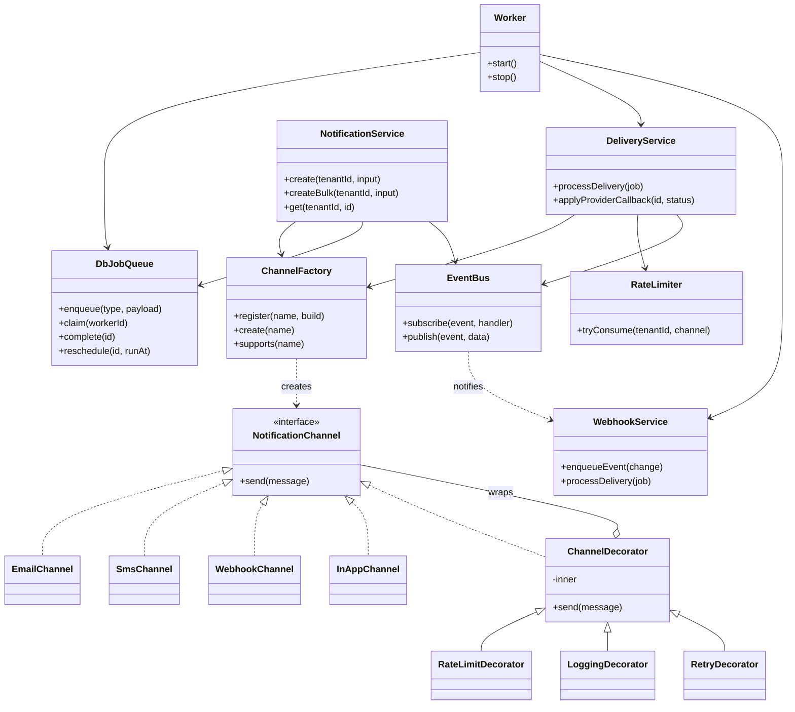
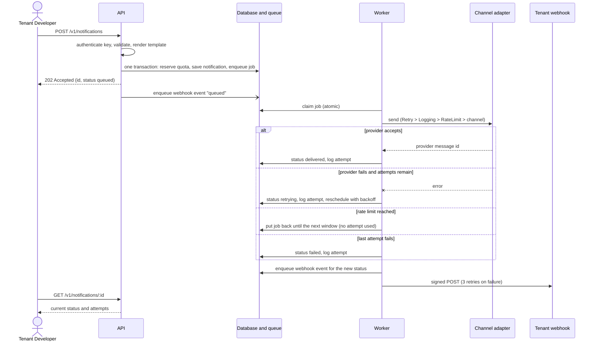

# NotifyHub architecture

## Big picture

```
 Tenant app ──(API key)──►  API process (Express)                     Worker process(es)
 Dashboard  ──(JWT)──────►  validate · render template                pick a job from the queue
                            reserve plan quota                        │
                            save notification + enqueue job  ──┐      ▼
                            answer 202 immediately             │   DeliveryService
                                                               │      channel = ChannelFactory.create(name)
                      ┌────────── Database ◄───────────────────┘      wrapped by decorators:
                      │  tenants · users · api_keys                    Retry( Logging( RateLimit( channel ) ) )
                      │  templates · template_versions                 │
                      │  notifications · delivery_attempts             ├─► status change ─► EventBus ─► WebhookService
                      │  jobs (the queue) · rate_counters              │                         └─► signed POST job
                      │  webhook_* · usage · billing · outbox          └─► retry later / failed / delivered
                      └───────────────────────────────────────────────
```

The API never waits for a provider. It stores the message and a job in **one transaction**, then returns. Workers do the
slow part, so one slow email server cannot slow the API and workers can be added without code changes.

## Design patterns

| Pattern | Where | Why |
|---|---|---|
| **Strategy** | `NotificationChannel` and `EmailChannel`, `SmsChannel`, `WebhookChannel`, `InAppChannel` | channels are interchangeable behind one `send(message)` method |
| **Factory** | `ChannelFactory.create(name)` and `register(name, build)` | the dispatcher never names a concrete class. A new channel is one `register()` call (Open/Closed) |
| **Decorator** | `RateLimitDecorator`, `LoggingDecorator`, `RetryDecorator` over `ChannelDecorator` | retry, logging and rate limiting are layered around any channel without changing it |
| **Observer** | `EventBus`; subscribers: webhook dispatcher, structured logger | status changes are announced; the publisher does not know who listens |
| **Repository** | `src/repositories/*` | all SQL in one layer; every tenant-facing method takes `tenantId` (NFR-04) |
| **Composition root** | `src/container.js` | all objects are created and wired in one place; services receive their dependencies |
| **Adapter** | `SqliteDatabase`, `PostgresDatabase` behind one interface; `MockBillingProvider` / `StripeBillingProvider` | storage engine and billing provider are replaceable |
| **Singleton (flyweight)** | one instance per channel kept by `ChannelFactory` | e.g. one SMTP transport |

SOLID in practice: each service has one job (S); new channels and billing providers need no edits to existing code (O);
all channels and decorators honour the same `send` contract (L); small interfaces (I); services depend on injected
repositories and the factory, not on concrete classes (D).

## Class diagram (core delivery path)



## Sequence: sending one notification



## Reliability details

* **Atomic claim:** one `UPDATE ... WHERE id = (SELECT ... LIMIT 1) AND status = 'queued' RETURNING *` statement; two workers can never take the same job.
* **Crash recovery:** a job locked longer than `JOB_LOCK_TIMEOUT_MS` returns to the queue (at-least-once).
* **No duplicates:** a notification already `sent`/`delivered`/`failed` is skipped; the simulated provider stores each message once per notification id; an `Idempotency-Key` makes API retries safe.
* **Rate limiting:** fixed window per tenant and channel stored in `rate_counters` with an atomic upsert, so every worker shares the same counters. The limit is cached for a few seconds, so changes apply almost immediately.
* **Backoff:** delay before retry n is `RETRY_BASE_MS x 2^(n-1)`, capped by `RETRY_MAX_MS`.
* **Transactions:** the SQLite adapter serialises all statements through one queue so a transaction is never interleaved with another request. PostgreSQL uses one pooled connection per transaction.

## Security notes

* Passwords: scrypt with a random salt. API keys: random 192-bit secret, shown once, stored as a salted SHA-256 hash, compared in constant time.
* Tenant isolation: the tenant comes only from the verified credential; repositories require `tenantId`; foreign ids return the same 404 as missing ids.
* Output safety: HTML-escaped template values for email and in-app; the dashboard writes data with `textContent` only; strict Content-Security-Policy (`script-src 'self'`, no inline styles or scripts).
* CSV export neutralises spreadsheet formulas and masks recipients.
* Webhook payloads are HMAC-SHA256 signed. In production, `http` and private-network webhook targets are refused (a basic SSRF guard that checks the URL text; it does not resolve DNS).
* Login lockout after `LOGIN_MAX_ATTEMPTS` failures. There is no per-IP throttle on other endpoints; put a reverse proxy or rate-limiting layer in front for public deployments.
